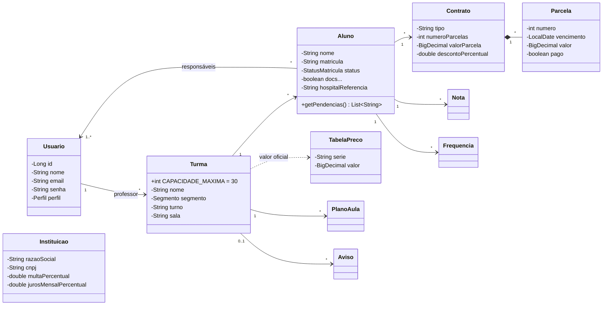

# 🌱 Semeando Digital

Sistema de Gestão Escolar (SGE) desenvolvido como projeto acadêmico (PjBL — Programação Orientada a Objetos, Engenharia de Software) para o **Centro Educacional Semeando**, escola comunitária de São Luís/MA que atende turmas do Maternal I ao 5º ano.

Hoje a escola gerencia matrículas, contratos e cobranças em arquivos de Word avulsos, o que gera retrabalho, valores de mensalidade divergentes da tabela oficial e risco à LGPD. O Semeando Digital centraliza essas informações em um único sistema, com perfis de acesso para **gestão/secretaria, professor, aluno e responsável**.

> ⚠️ Todos os dados do sistema são **fictícios** (LGPD, art. 14).

## Funcionalidades
- **Matrícula:** pré-matrícula, aprovação/rejeição, checklist de documentos e limite de 30 alunos por turma.
- **Financeiro:** cobrança dual (taxa de associado na Educação Infantil e mensalidade no Fundamental), validação contra a tabela oficial, multa e juros automáticos e boletos (integração CORA simulada).
- **Pedagógico:** diário de classe (chamada, notas e conteúdo), planos de aula e boletim.
- **Portal da família:** boletim, frequência, avisos, calendário, materiais e dados de emergência.
- **Conformidade:** log de auditoria, prazos de SMTT/Censo/Sistema Presença, exportação CSV e backup.

## Stack
| Camada | Tecnologias |
|---|---|
| Backend | Java 21, Spring Boot 3.3 (Web, Data JPA, Validation), PostgreSQL (persistente), Lombok, BCrypt |
| Frontend | React 18, React Router 6, Vite 5, CSS puro (layout responsivo) |
| Infra | Docker Compose (PostgreSQL + backend + frontend/Nginx) |
| Build | Maven, npm |

## Como rodar localmente

### Pré-requisitos
- [Docker Desktop](https://www.docker.com/products/docker-desktop/) (inclui o Docker Compose) em execução
- [Git](https://git-scm.com/)

> Não é preciso ter Java, Maven, Node ou PostgreSQL instalados: tudo roda em contêineres.

### 1. Clonar o repositório
```bash
git clone https://github.com/RoberthFurtadoDev/semeando-digital.git
cd semeando-digital
```

### 2. Configurar variáveis
```bash
cp .env.example .env   # no Windows: copy .env.example .env
```
Ajuste a senha do banco no `.env`.

### 3. Iniciar
**Atalho:** no Windows, dê dois cliques em `iniciar.bat`; no Linux/Mac, rode `./iniciar.sh`.

**Ou diretamente:**
```bash
docker compose up --build
```
Isso sobe três serviços: **PostgreSQL**, **backend** (http://localhost:8080) e **frontend** (http://localhost:5173).

### 4. Acessar
Abra **http://localhost:5173** e entre com um dos usuários abaixo (senha `123456`):

| Perfil | E-mail |
|---|---|
| Gestão / Secretaria | `gestor@exemplo.com` |
| Professor(a) | `professor@exemplo.com` |
| Aluno(a) | `aluno@exemplo.com` |
| Responsável | `responsavel@exemplo.com` |

> Os dados ficam no volume `pgdata` do PostgreSQL e **persistem** entre reinicializações. A massa fictícia só é criada no primeiro start (quando o banco está vazio). Para zerar: `docker compose down -v`.

### Perfis e cadastro de usuários
O acesso é por **e-mail e senha** (senha inicial `123456`, com hash BCrypt). Não há autocadastro: **todos os usuários são criados pela gestão/secretaria**.

| Perfil | Quem cadastra | Onde, na interface da gestão |
|---|---|---|
| **Professor** | Gestão | *Turmas e Professores* → "＋ Professor" |
| **Responsável** | Gestão | *Matrículas* → "＋ Pré-matrícula" (o acesso do responsável é criado junto) |
| **Aluno** | Gestão | *Matrículas* → ficha de um aluno matriculado → "Gerar acesso do aluno" |

### Rodar sem Docker (opcional, só para desenvolvimento)
Precisa de Java 21 + Node 18+. O backend pode usar um banco H2 em memória (sem persistência) com o profile `h2`:
```bash
cd backend && mvn spring-boot:run -Dspring-boot.run.profiles=h2   # API em :8080
cd frontend && npm install && npm run dev                          # interface em :5173
```

## Estrutura
```
semeando-digital/
├── backend/             API REST (Spring Boot)
│   └── src/main/java/com/semeando/
│       ├── model/       entidades de domínio
│       ├── repo/        repositórios JPA
│       ├── service/     regras de negócio
│       ├── web/         controllers REST por perfil
│       └── config/      dados fictícios, CORS e erros
├── frontend/            interface (React + Vite)
│   └── src/
│       ├── pages/       telas por perfil
│       ├── components/  layout e componentes de UI
│       └── demo/        backend em JS para a versão online
└── docs/UML.md          diagramas UML
```

## UML
Diagrama de classes do domínio (o detalhamento e os demais diagramas estão em [`docs/UML.md`](docs/UML.md)):



## Licença
Projeto acadêmico, sem fins comerciais.
